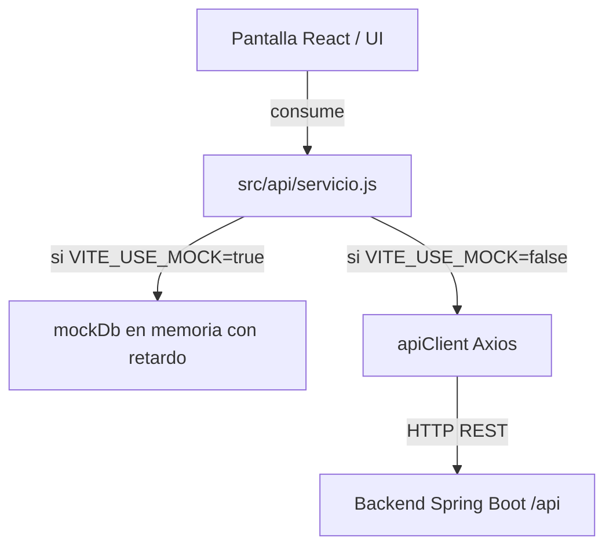

# Capa API y Mocks en Academit

Este documento describe la arquitectura de la capa de datos de **Academit**, el funcionamiento de la bandera `VITE_USE_MOCK`, el manejo de errores HTTP y la estrategia para transicionar pantallas hacia los controladores reales de Spring Boot sin reescribir la interfaz.

---

## 1. Arquitectura de Desacoplamiento

El frontend está diseñado bajo el principio de **desacoplamiento total**:
- Las pantallas (`src/pages/*`) **nunca importan ni conocen la existencia de `mockDb`**.
- Las pantallas consumen exclusivamente funciones asíncronas de servicio definidas en `src/api/*.js` (`getAlumnos()`, `createCurso()`, `registrarPago()`, etc.).
- Toda la decisión sobre si llamar a la red real o simular la operación en memoria reside internamente en cada función del módulo API.



---

## 2. Cómo Funciona `VITE_USE_MOCK`

En `src/api/client.js` se define:
```javascript
import axios from 'axios'

const apiClient = axios.create({
  baseURL: '/api',
  headers: {
    'Content-Type': 'application/json',
  },
})

export const isMock = import.meta.env.VITE_USE_MOCK === 'true'
export default apiClient
```

Cuando un componente invoca una función de `src/api/alumnos.js`:
```javascript
export const getAlumnos = async () => {
  if (isMock) {
    // 1. Simula latencia de red real para evaluar spinners y estados de carga
    await new Promise((resolve) => setTimeout(resolve, 150))
    // 2. Retorna una copia de los datos simulados
    return [...mockDb.alumnos]
  }

  // Si isMock es false, se realiza la llamada HTTP real
  const response = await apiClient.get('/alumnos')
  return response.data
}
```

---

## 3. Manejo de Errores

Tanto en modo mock como en modo real, las funciones de `src/api/` lanzan excepciones estándar de JavaScript (`throw new Error(...)`) o rechazos de Axios (`AxiosError`).

En las pantallas, el manejo de errores se implementa con bloques `try / catch / finally` combinados con el sistema de notificaciones contextuales `useToast`:

```jsx
const handleSubmit = async (e) => {
  e.preventDefault()
  setLoading(true)
  try {
    await updateAlumno(id, datosFormulario)
    showToast('Alumno actualizado exitosamente', 'success')
    cargarDatos()
  } catch (err) {
    // Si el backend devuelve un mensaje de validación o conflicto (HTTP 400 / 409)
    const mensaje = err.response?.data?.message || err.message || 'Error al procesar la operación'
    showToast(mensaje, 'danger')
  } finally {
    setLoading(false)
  }
}
```

---

## 4. Cómo Pasar una Pantalla de Mock a API Real

El pasaje de una maqueta interactiva a la integración completa con Spring Boot no requiere modificar una sola línea de código en los componentes ni en las pantallas:

### Paso 1: Configurar la variable de entorno
En el archivo `.env.development` (o `.env.production`):
```env
VITE_USE_MOCK=false
```

### Paso 2: Configurar el Proxy en `vite.config.js` (si se corre en desarrollo)
Para evitar problemas de CORS durante el desarrollo local, Vite reenvía las peticiones `/api` al puerto de Spring Boot (por defecto `8080`):

```javascript
// En frontend/vite.config.js
export default defineConfig({
  server: {
    proxy: {
      '/api': {
        target: 'http://localhost:8080',
        changeOrigin: true,
      },
    },
  },
})
```

### Paso 3: Verificar los contratos de datos
Debido a que los campos de los mocks fueron diseñados siguiendo fielmente el modelo relacional (DER) del instituto:
- `idAlumno`, `legajo`, `dni`, `fechaNacimiento`
- `idCarrera`, `idPlan`, `idCurso`, `cuposDisponibles`
- `idCuota`, `monto`, `fechaVencimiento`, `medioPago`

El payload JSON recibido desde Spring Boot encajará directamente en las tablas y formularios de la aplicación.
